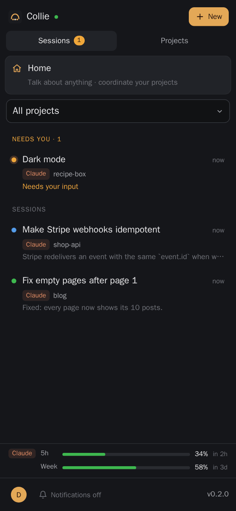
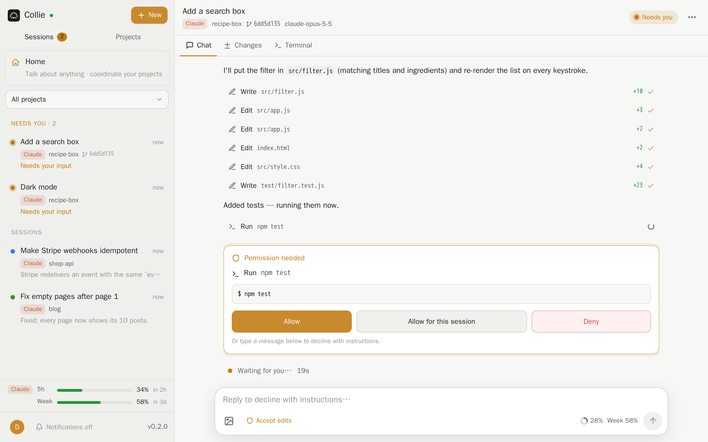

# Collie 🐕

[English](README.md) | **日本語**

Claude Code / Codex を複数同時に動かすための、セルフホスト型 Web UI です。スマホなどどの端末からでも使えます。独自ドメインでインターネットに公開しても、Tailscale の中だけで使ってもかまいません。

Linux サーバ（または Mac）に置いておけば、どこからでもエージェントを走らせて、承認して、差分を確認できます。

<p align="center">
  
</p>

<picture>
  <source media="(prefers-color-scheme: dark)" srcset="docs/images/desktop-dark.png">
  
</picture>

- **単一バイナリ**（約 13MB、UI 込み）。Let's Encrypt の証明書取得も内蔵
- **並列セッション**: セッションごとに git worktree を切るので、同じリポジトリでも衝突しない
- **スマホで承認**: 権限の確認・質問・計画の承認は *Needs you* に集まる
- **エージェントが見せてくれる**: スクショ・操作の録画・HTML のページが、チャットの中にそのまま出る
- **プロジェクトごとのサンドボックス**: rootless Podman コンテナで動き、見えるのはそのプロジェクトだけ。LAN には出られない
- **マルチユーザー**: パスキーでログイン、招待リンク、グループで共有するプロジェクト。エージェントは各自の Claude / Codex アカウントで動く
- **Home**: 自分の全プロジェクトを把握していて、代わりにセッションを立てたり指示したりできるエージェント

> [!IMPORTANT]
> Collie にログインした人は、サーバ上でコマンドを実行できます。ログインはパスキーだけなのでインターネットに公開できますが、[セットアップ](docs/setup.ja.md)のとおり HTTPS で公開し、招待リンクやログイン中の端末はサーバの鍵と同じように扱ってください。詳しくは[セキュリティ](docs/security.ja.md)を参照してください。

## 試す

[mise](https://mise.jdx.dev/) と `git` が必要です。Go と Node.js はプロジェクトで固定したバージョンを mise が入れます。

```bash
mise trust && mise install
mise run build
./bin/collie
```

表示された URL（ログイン用トークン付き）を開きます。Podman が入っていなければ、エージェントはこのマシン上で、あなたの `claude` / `codex` のログインのまま動きます。

## もっと知る

- **[セットアップ](docs/setup.ja.md)**: サーバへの常駐（独自ドメイン・リバースプロキシ・Tailscale）、最初の管理者になる、アップデート
- **[しくみ](docs/how-it-works.ja.md)**: プロジェクトとセッション、隔離、ユーザーとグループ、skill・MCP、Home
- **[セキュリティ](docs/security.ja.md)**: インターネットからのログイン、何から何が隔離されているか、されていないか
- **[リリースの作り方](docs/releasing.ja.md)**: 署名付きリリースを出す（メンテナ向け）
- `collie --help`: フラグと管理用コマンド

## 開発

```bash
mise run dev            # API（127.0.0.1:7878、認証なし）
cd web && npm run dev   # UI（http://localhost:5173、/api をプロキシ）
mise tasks              # その他のタスク: test・cross・install など
```

## ライセンス

[MIT](LICENSE)
