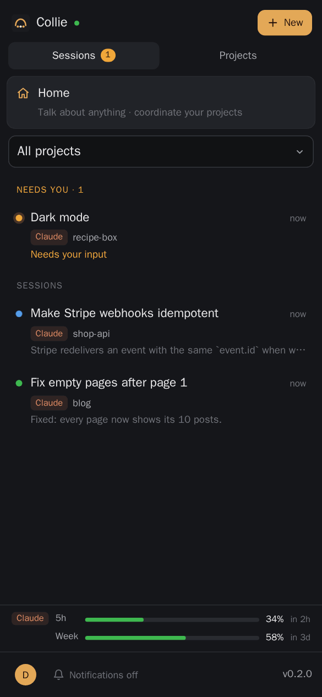
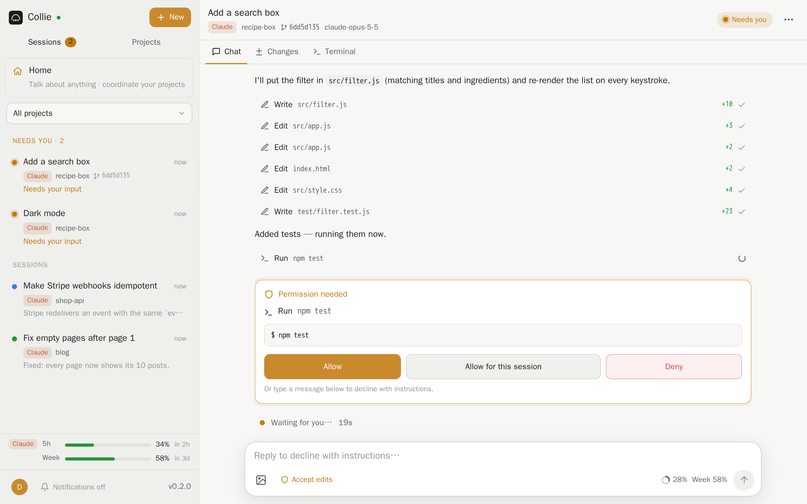

# Collie 🐕

**English** | [日本語](README.ja.md)

A self-hosted web UI for running many Claude Code and Codex sessions at once, from your phone or any other device: over the internet on your own domain, or privately over Tailscale.

Put it on a Linux server (or your Mac), then start agents, approve their actions and review their diffs from anywhere.

<p align="center">
  
</p>

<picture>
  <source media="(prefers-color-scheme: dark)" srcset="docs/images/desktop-dark.png">
  
</picture>

- **One binary** (about 13 MB, UI included), with HTTPS certificates from Let's Encrypt built in
- **Parallel sessions**, each in its own git worktree so they don't collide
- **Approve from your phone**: permission requests, questions and plans wait for you under *Needs you*
- **Agents can show you things**: screenshots, screen recordings and HTML pages appear right in the chat
- **A sandbox per project**: a rootless Podman container that sees only that project and can't reach your LAN
- **Multi-user**: passkey sign-in, invite links and shared group projects. Everyone's agents run on their own Claude / Codex account
- **Home**: an agent that knows all your projects and can start or steer sessions for you

> [!IMPORTANT]
> Whoever signs in to Collie can run commands on your server. Sign-in is passkey-only, so Collie can face the internet, but serve it over HTTPS as in [Setup](docs/setup.md) and treat invite links and signed-in devices like keys to the server. See [Security](docs/security.md).

## Try it

You need [mise](https://mise.jdx.dev/) and `git`. mise installs the Go and Node versions the project pins.

```bash
mise trust && mise install
mise run build
./bin/collie
```

Open the URL it prints, which includes a sign-in token. If Podman isn't installed, agents run directly on this machine with your own `claude` / `codex` logins.

## Learn more

- **[Setup](docs/setup.md)**: running it on a server (your own domain, a reverse proxy or Tailscale), becoming the first admin, updating
- **[How it works](docs/how-it-works.md)**: projects and sessions, isolation, users and groups, skills & MCP, Home
- **[Security](docs/security.md)**: signing in from the internet, what is isolated from what, and what isn't
- **[Releasing](docs/releasing.md)**: publishing a signed release (maintainers)
- `collie --help`: flags and admin commands

## Development

```bash
mise run dev            # API on 127.0.0.1:7878, no auth
cd web && npm run dev   # UI on http://localhost:5173 (proxies /api)
mise tasks              # everything else: test, cross, install, …
```

## License

[MIT](LICENSE)
