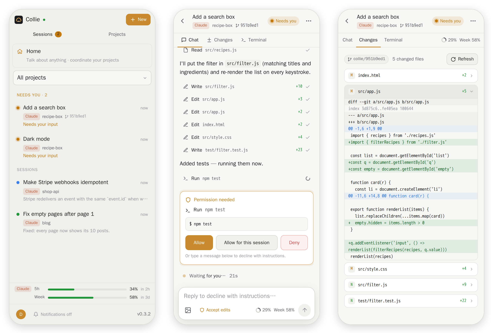

# しくみ

[English](how-it-works.md) | **日本語** · [← README](../README.ja.md)

## プロジェクトとセッション

<picture>
  <source media="(prefers-color-scheme: dark)" srcset="images/mobile-dark.png">
  
</picture>

**プロジェクト**はサーバ上のフォルダです。新規作成するか、リポジトリを clone します。管理者は既存のフォルダも登録できます。**セッション**は、プロジェクトの中でエージェント（Claude Code または Codex）とする 1 本の会話です。

- **Isolated worktree** を選ぶと、セッションごとに `collie/<id>` ブランチと専用のチェックアウトが作られます。同じリポジトリで複数のセッションが同時に作業できます。作成時に upstream（なければリモートのデフォルトブランチ）を fetch し、手元のブランチが古ければ upstream の先頭から始めます。手元のブランチは動かさず、未 push のコミットはそのまま残ります。コンテナで動くプロジェクトでは、これをプロジェクトのコンテナの中で行うので、fetch はそのプロジェクトのネットワーク設定とエージェントの認証情報を使います。コミットがまだないリポジトリ（新規プロジェクトや空のリポジトリの clone）では、最初の worktree セッションを始めるときに、分岐元として空の「Initial commit」を作ります。
- エージェントのプロセスは 30 分使われないと止まります。次のメッセージで会話の続きから再開し、これはサーバを再起動したあとでも同じです。
- 実行中にメッセージを送ると、追加の指示としてエージェントに届きます。承認待ちの間に送ったメッセージは、リクエストを却下したうえで、その文面を添えて渡されます。

## 定期実行

サイドバーの **定期実行** から、決めた時刻に同じ指示でセッションを起動できます。毎日・平日・曜日指定・毎月・毎時のほか、cron 式でも指定でき、タイムゾーンも選べます。「今すぐ実行」ですぐに 1 回起動することもできます。

- 実行のたびに新しいセッションができ、セッション一覧に時計の印が付きます。エージェントはあなたのアカウントと全セッション共通の指示で動き、定期実行の設定はあなたにしか見えず、あなたしか変更できません。
- モデルと推論レベルを「あなたの既定」のままにすると、実行のたびにその時点の新しいセッションの既定値を使います。
- 実行が重なることはありません。前回の実行が作業中・承認待ち・バックグラウンド作業の途中のときは、その回を飛ばして履歴に残します。
- 予定の時刻に Collie が止まっていた場合（停止中・アップデートの再起動中など）は、何回分逃していても、起動したときに 1 回だけ実行します。
- 実行はあなたが不在のときに始まることがあります。先に確認する権限モードだと最初の承認で止まって **Needs you** で待ち、それが終わるまで次の回は飛ばされます。
- 間隔は 5 分以上です。夏時間の切り替えで存在しない時刻はその日は実行されず、2 回ある時刻は 1 回だけ実行します。

## スクショ・動画・HTML

どのセッションのエージェントも、ファイルをチャットの中に出して見せられます。「デザイン案を 3 つ作ってスクショで見せて」「ログインの流れを録画して見せて」「解説を HTML で書いて見せて」のように頼んでみてください。

- Playwright で録画すると WebM になります。iPhone で再生できないときは、MP4 で書き出すよう頼んでください。
- HTML のページは、ネットワークに出られないサンドボックスの中で開きます。そのため、スタイルや画像を埋め込んだ 1 ファイルで書いてもらう必要があります（エージェントにもそう伝えてあります）。スクリプトは **Run scripts** を押したときだけ動きます。

## 通知

通知を受け取りたい端末ごとに Account → **通知** でオンにして、**テスト通知を送る** で確かめてください。自分が始めたセッションが承認や回答を待っているとき、完了したとき、エラーで止まったときに、Collie を閉じていても届きます。

- iPhone・iPad（iOS 16.4 以降）では、先に Collie をホーム画面に追加し（共有 → ホーム画面に追加）、そのアイコンから開いた Collie で通知をオンにします。
- バージョン 0.4.0 以前でホーム画面に追加した Collie が上に寄っていて、画面の下に何もない帯が出るときは、アイコンを削除して追加し直してください。iOS は、ステータスバーの設定をアイコンを追加した時点のまま使い続けます。追加し直したら、新しいアイコンで通知をもう一度オンにしてください（サインインを求められたらサインインも）。
- Collie を前面で開いている端末には、ページ自身が通知を出します。二重には届きません。
- サーバから各ブラウザのプッシュ通知サービスに HTTPS で接続できる必要があります: `fcm.googleapis.com`（Chrome・Android）、`push.services.mozilla.com`（Firefox）、`web.push.apple.com`（Safari・iPhone）、`notify.windows.com`（Edge）。
- Tailscale 経由で使っている場合、通知はスマホが tailnet につながっていなくても届きますが、タップして開くには Tailscale の接続が必要です。

## 開発サーバ

エージェントにアプリを起動してもらい（`npm run dev` など）、セッションの **Ports**（ポート）タブを開きます。プロジェクトのコンテナで待ち受けているものが、このセッションのものを先頭に並び、タップすると新しいタブで開きます。ホットリロードも動き、いくつか同時に開けます。自分のセッションのサーバを開けるのは自分だけです（共有したセッションでも同じ）。プレビューの配信先はサーバ側で設定します（[セットアップ](setup.ja.md#プレビュー)）。

## 隔離

新しいプロジェクトは、既定で **Isolated container** で動きます。Project → Settings で変更できます。

- プロジェクトとユーザーの組ごとに rootless Podman コンテナが 1 つ立ちます。そのユーザーがそのプロジェクトで使うエージェントとターミナルは、すべてこの中で動きます。
- コンテナから見えるのは、そのプロジェクトのフォルダと worktree だけです。Collie のデータ、ほかのプロジェクト、ホストの `~/.claude` は見えません。
- プロジェクトが mise で入れたツール（`mise.toml` や `.tool-versions` をもとに `mise install`）は、コンテナの中ではコマンド名だけで使えます。コンテナの中では、mise の設定は `mise trust` なしで信頼されます。イメージにもともと入っているもの（Node.js・Python）はイメージの版が優先されるので、プロジェクトの版は `mise exec -- node` のように実行します。
- メモリ・CPU・プロセス数に上限があります。既定値は 4GB・コア数の半分・4096 で、管理者がプロジェクトごとに変更できます。
- エージェントが暴走したら、**Kill now** でコンテナごと止められます。会話は次のメッセージで再開します。
- プロジェクトのオーナーは、Project → Settings → **Network** でコンテナの接続先を選べます。**Allowlist only** にすると、接続できるのはリストのホストと、Claude・Codex 自身のサービスだけになります。`HTTPS_PROXY` を使うツール（`https://` の git を含む）はそのまま動きますが、SSH などの直接の接続は外に出られないので、リモートは `https://` にして `GH_TOKEN` を使ってください。ブロックされたホストは **Recent connections** に出て、ワンタップで許可できます。リストの変更はすぐに反映されます。「インターネット」と「許可リストのみ」を切り替えると、ターミナルも含めてプロジェクトのコンテナが再起動します。こうしたプロジェクトの中で（**コンテナの中でコンテナを動かせるようにする** を使って）起動したコンテナは、単独ではインターネットに出られません。
- エージェントは箱の中にいるので、承認なしで任せる運用（Claude の **Bypass**、Codex の **Full access**）も選びやすくなります。モードは入力欄のチップからいつでも切り替えられます。
- 管理者はプロジェクトごとに **コンテナの中でコンテナを動かせるようにする（Podman）** をオンにできます（Collie 自体の開発などに）。そのプロジェクトのコンテナでは、エージェントが `podman` を使えます。イメージはユーザー × プロジェクトごとに保存され、サーバのディスクを使います。設定はコンテナの再起動時に反映されます。Collie を更新した後の最初の起動では、エージェント用イメージが作り直されます。

## エージェント用イメージ

コンテナは Collie の標準イメージで動きます。Ubuntu に Claude Code・Codex・Playwright・mise とよく使うツールを入れたものです。システムのパッケージ、社内の CA 証明書、社内ツールなど、チームにそれ以上のものが必要なら、管理者が Admin → Containers でイメージを追加できます。イメージの中身は数行の Containerfile で、Collie が標準イメージの上に重ねてビルドします。

- プロジェクトのイメージは、そのプロジェクトを管理する人（オーナー、グループならグループのオーナー）が Project → Settings で選びます。選んでいないプロジェクトと全員の Home は、管理者が決めたデフォルトのイメージで動きます。
- イメージが `USER` や `ENTRYPOINT` に何を指定していても、エージェントは `collie` ユーザーとして動き、見えるファイル・ネットワーク・上限も変わりません。Claude Code・Codex・Collie の補助コマンドがなくなるビルドは受け付けません。
- 定義を変えたときと、アップデートで標準イメージが新しくなったときに、Collie がイメージを作り直します。新しいビルドが成功するまでは前のビルドで動き続けるので、ビルドに失敗しても誰の作業も止まりません。エージェントが待たされるのは、そのイメージの最初のビルドのときだけです。**Rebuild** はキャッシュを使わずに作り直すので、新しいパッケージを取り込めます。
- ビルドもエージェントと同じファイアウォールの内側で動くので、LAN や tailnet には届きません。社内ネットワークのレジストリやパッケージのミラーを使うには `setup-host.sh --allow` で許可してください。その場合、エージェントからもそこに届くようになります。private なレジストリには、`collie` ユーザーで `podman login` してください。そのログイン情報はエージェントからは見えません。
- ファイルをコピーしてくるフォルダはありません。ヒアドキュメント（`COPY <<'EOF' /path`）で書き込むか、`COPY --from=` でほかのイメージから取り込んでください。
- イメージごとに、そのレイヤーの分だけサーバのディスクを使います。

## ユーザーとグループ

- 個人のプロジェクトと会話は、本人にしか見えません。管理者からも見えません。
- **グループのプロジェクト**では、メンバー全員がファイルと Changes を共有します。セッションは既定でグループに共有され（**Make private** で非公開にもできます）、メンバーは会話を見て、指示・承認・中断ができます。
- エージェントは常に、そのセッションを**始めた人**のアカウント（その人がそのプロジェクトで選んだ Claude アカウント）で動きます。メッセージを送った人のアカウントではありません。
- ターミナルは、開いた本人にしか見えません。
- 管理者は、ユーザーの招待と管理、全体共通の skill・MCP・環境変数の編集、ホスト実行のプロジェクト・既存フォルダ・リソース上限の管理ができます。

## skill・MCP・指示

設定は 2 層あり、エージェントの起動時に合成されます:

- **全体共通**: 管理者が Admin → Global skills & MCP で編集
- **個人**: 各自が Account → My skills & MCP で編集

名前がぶつかったときは個人の設定が優先されます。その上に、リポジトリ自身の `.claude/`・`.mcp.json`・`AGENTS.md` が効きます。環境変数は「全体 < 個人 < プロジェクト」の順に上書きされます。Playwright MCP は最初から有効です。

Claude の auto memory は、同じプロジェクトの自分のセッションの間で共有されます。グループのプロジェクトでは、メンバー全員で共有されます。

**新しいセッションの既定値**は Account → Agent accounts → New sessions で設定します。エージェントごとのモデルと推論レベル、それに全セッション共通の指示（例:「PR のタイトルは英語で」）です。

- 新規セッション画面はこのモデルと推論レベルで始まり、Home エージェントも自分で選ばない限りこれを使います。推論レベルは、セッションが動き出したあとは変えられません。
- 指示はエージェントのシステムプロンプトに追加されます（Claude Code は `--append-system-prompt`、Codex は developer instructions）。ホスト実行のプロジェクトや Home でも同じです。あなたのメッセージやリポジトリのファイルは書き換えません。Codex では、自分の Codex 設定にある `developer_instructions` の代わりに使われます。
- 見えるのは自分だけで、渡されるのも自分が始めたセッションだけです。グループのプロジェクトで共有したセッションには、始めたメンバーの指示が渡されます。
- 変更は、そのあと始めるセッションから反映されます。進行中のセッションは前の指示のままのことがあります。

## Claude Code プラグイン

プラグインは 5 つの範囲でオンにできます。あとの範囲ほど優先され、「オフ」にすると、より広い範囲でオンにしたプラグインをその範囲では入れません。

- **全体**: 管理者が Admin → 全体共通のプラグイン で設定
- **グループ**: グループのオーナーがグループの画面で設定。そのグループのプロジェクトに効きます
- **個人**: 各自が Account → 自分のプラグイン で設定
- **プロジェクト**: プロジェクトの管理者が Project → Settings で設定
- **リポジトリ**: リポジトリの `.claude/settings.json` の `enabledPlugins`

Project → Settings に、そのプロジェクトで自分のエージェントに入るプラグインと、それぞれをどの範囲で決めたかが表示されます。

- Collie は、Claude の起動直前とターミナルを開いたときに、自分のコンテナへプラグインをインストールします。進み具合と失敗はセッションに表示されます。変更は、そのあと起動するエージェントに反映されます。
- インストールはプロジェクト × ユーザーごとです。変更後、各プロジェクトの最初のセッションは起動に少し時間がかかります。
- Collie が削除するのは、自分でインストールしたプラグインだけです。ターミナルで自分で入れたプラグインは、どこかの範囲でオフにしても残ります。
- プラグインが入るのは隔離実行のプロジェクトだけです。ホスト実行のプロジェクトはサーバユーザーの `~/.claude` を使い、Collie はそこに手を加えません。
- 許可リスト方式のプロジェクトでは、プラグインの取得元も許可リストに入れておく必要があります。多くは GitHub（`github.com`、`*.githubusercontent.com`）から取得します。

## Home

サイドバーのいちばん上にある **Home** は、どのプロジェクトにも属さない会話です。何でも相談でき、プロジェクトをまたいだ仕事も頼めます:

- 「今週何やった？」「sample2 の認証まわりどうなってる？」と聞くと、プロジェクト・セッション履歴・コードを読んで答えます。
- 「sample2 でテスト直すセッション立てといて」と頼むと、セッションを立てたり、既存のセッションに指示を送ったりします。
- 「毎週金曜 18 時に今週マージされた内容をまとめて」と頼むと、定期実行を登録します。一覧と削除もできます。
- 「終わったら差分を確認して教えて」と頼めます。Home は自分が立てたセッションを見守ります。セッションのターンが終わる・あなたの対応を待つ・失敗すると、Collie が短い通知で Home を起こし、Home がセッションと差分を読んで次につなげます。セッションの停止やアーカイブもできます。

Home 自身はプロジェクトを編集しません。編集は Home が立てたセッションが行い、その承認はこれまでどおり **Needs you** に届きます。Home から見えるのは、あなたが見られるものだけです。Home がコンテナで動くとき（Podman のある Linux）は、ホスト実行のプロジェクトでエージェントを起動・指示・定期実行しません。それは Collie からあなたが行ってください。

Home がセッションを見守るとき:

- 通知のたびに Home のターンが 1 回動き、メッセージを送ったときと同じようにプランの使用量を使います。あるセッションの通知を止めるには、通知の **見守りをやめる**、セッションのメニューの **Home の見守りをやめる** を使うか、Home に頼んでください。
- 通知は Home の今のターンが終わってから届き、短い間に続いた変化は 1 通にまとまります。同じセッションについての通知が 30 回になると、Collie はそのセッションの見守りを終えます。
- Home が停止・アーカイブするのは、あなたが始めたセッションだけです（グループのオーナーでも、ほかのメンバーのセッションには触れません）。worktree やブランチは削除しません。
