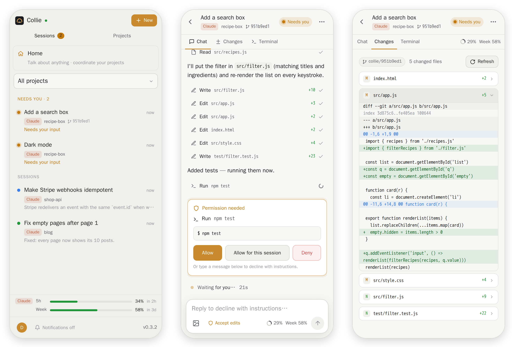

# How it works

**English** | [日本語](how-it-works.ja.md) · [← README](../README.md)

## Projects and sessions

<picture>
  <source media="(prefers-color-scheme: dark)" srcset="images/mobile-dark.png">
  
</picture>

A **project** is a folder on the server. You can create a new one, clone a repository, or, as an admin, register an existing folder. A **session** is one conversation with one agent (Claude Code or Codex) in a project.

- With **Isolated worktree**, a session gets its own `collie/<id>` branch and checkout, so several sessions can work on the same repository at once. When it is created, Collie fetches the branch's upstream and starts from its tip if your local branch is behind. Your local branch is never moved, and unpushed local commits are kept.
- An agent process stops after 30 idle minutes. Your next message resumes the conversation, and that works after a server restart too.
- Messages you send while the agent is running reach it as extra instructions. A message typed while an approval is waiting denies the request and passes your text along with the denial.

## Screenshots, videos and HTML

Agents in every session can show you files right in the chat. Try asking "make three design options and show me screenshots", "record the sign-in flow and show me" or "write it up as an HTML page and show me".

- Playwright records video as WebM. If a video won't play on your iPhone, ask for MP4.
- HTML pages open in a sandbox without network access, so they have to be a single file with styles and images embedded. The agent is told this. Scripts run only after you press **Run scripts**.

## Isolation

New projects run in an **Isolated container** by default. You can change this in Project → Settings.

- Each project and user pair gets its own rootless Podman container. That user's agents and terminals for the project all run inside it.
- The container sees only that project's folder and its worktrees. Collie's data, other projects and your host `~/.claude` are not visible.
- Toolchains the project installs with mise (`mise install`, from its `mise.toml` or `.tool-versions`) work by name in its containers, and its mise config is trusted there without `mise trust`. Where the image has its own (Node.js, Python), the image's comes first; run the project's with `mise exec -- node` and the like.
- Memory, CPU and process limits apply. The defaults are 4 GB, half the cores and 4096 processes, and admins can change them per project.
- If an agent runs away, **Kill now** stops the whole container. The conversation resumes on the next message.
- A project's owner can choose where its containers may connect in Project → Settings → **Network**. With **Allowlist only**, they reach only the listed hosts and Claude's and Codex's own services. Tools that use `HTTPS_PROXY` work as usual, including git over `https://`, but SSH and other direct connections can't get out, so use `https://` remotes with a `GH_TOKEN`. Hosts that were blocked show up under **Recent connections**, where one tap allows them. Edits to the list apply at once. Switching between Internet and an allowlist restarts the project's containers, terminals included. Containers started inside such a project (with **Allow containers inside**) have no internet of their own.
- Since the agent is boxed in, letting it run without approvals (Claude's **Bypass**, Codex's **Full access**) is easier to justify. You can switch the mode at any time from the chip in the message box.
- An admin can turn on **Allow containers inside (Podman)** for a project, for example to develop Collie itself there. Agents can then use `podman` in that project's containers. Each user's images are kept per project and count against the server's disk. Changes apply when the containers restart, and the first start after updating Collie rebuilds the agent image.

## Users and groups

- Personal projects and conversations are visible only to their owner. Admins can't see them either.
- In a **group project**, all members share the files and Changes. Sessions are shared with the group by default (you can choose **Make private**), so members can watch, instruct, approve and interrupt.
- An agent always runs on the account of the person who **started** the session (the Claude account they chose for that project), not the person sending the message.
- A terminal is visible only to the person who opened it.
- Admins invite and manage users, edit the global skills, MCP and environment variables, and manage host-run projects, existing folders and resource limits.

## Skills, MCP and instructions

There are two layers, and they are combined when an agent starts:

- **Global**, edited by admins in Admin → Global skills & MCP
- **Personal**, edited by each user in Account → My skills & MCP

Personal settings win when names clash. The repository's own `.claude/`, `.mcp.json` and `AGENTS.md` apply on top. Environment variables override in the order global < personal < project. Playwright MCP is enabled from the start.

Claude's auto memory is shared across your sessions in a project. In a group project, it is shared by all members.

## Claude Code plugins

Plugins can be turned on at five levels. A later level wins, and **Turn off** keeps a plugin turned on at a broader level out of that scope:

- **Global**: admins, in Admin → Global plugins
- **Group**: the group's owners, on the group's page. Applies to the group's projects
- **Personal**: each user, in Account → My plugins
- **Project**: the project's managers, in Project → Settings
- **Repository**: `enabledPlugins` in the repository's `.claude/settings.json`

Project → Settings shows which plugins your agents get there and which level decided each one.

- Collie installs them into your container right before Claude starts, and when you open a terminal. Progress and failures appear in the session. Changes reach agents started afterwards.
- Plugins are installed per project and user, so the first session after a change in each project takes a little longer.
- Collie removes only the plugins it installed. Plugins you install yourself in a terminal stay, even if a level turns them off.
- Only isolated projects get plugins. Host-run projects use the server user's own `~/.claude`, which Collie leaves alone.
- In a project on an allowlist, the plugins' sources must be on the list too. Most come from GitHub (`github.com`, `*.githubusercontent.com`).

## Home

**Home**, at the top of the sidebar, is a conversation that belongs to no project. You can ask it anything, including work that spans projects:

- "What did I do this week?" or "How does auth work in sample2?" It reads your projects, session history and code to answer.
- "Start a session in sample2 to fix the tests." It can start sessions and send instructions to existing ones.

Home can't edit projects itself. The sessions it starts do the editing, and their approvals still come to **Needs you**. It sees only what you can see.
